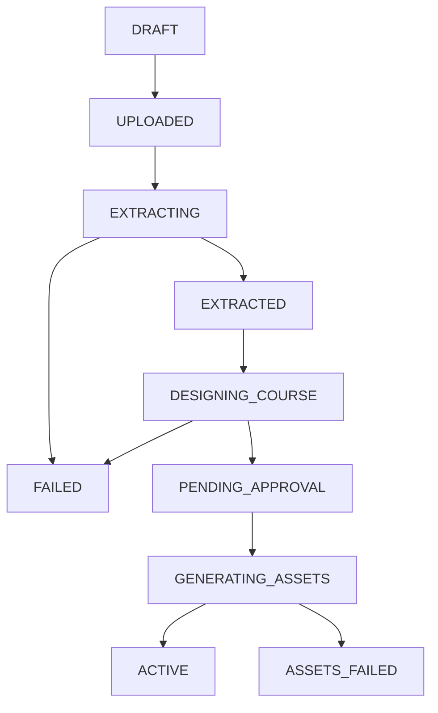

# Task WBS 4.1: Central Workflow Controller, Learner Progress & Recommendation Engine, and Event Ingestion

### Member Information
- **Member Name:** Member 1
- **Role:** Project Manager and Backend/Deployment Engineer
- **Assigned Work Package (WBS):** WBS 4.1 (Build central workflow controller, progress evaluation, event ingestion, and recommendation engine)
- **Task Name:** Central Workflow Controller, Progress Engine, and Event Ingestion
- **Week:** Weeks 7–9
- **Status:** COMPLETED & Fully Tested (13 Passing Tests, 164 Total Repository Regression Tests Passing)

---

## 1. Executive Summary & Objective

WBS 4.1 delivers the central operational nervous system of the **Eduvance AI** platform. Building directly upon the foundation established in **WBS 3.1** (Database, Auth, Storage) and coordinating the autonomous pipelines constructed in **WBS 3.2** (Extraction), **WBS 3.3** (Course Design), **WBS 3.4** (Video Generation), and **WBS 3.5** (Assessment Generation), this package implements:
1. **Central Workflow Controller & State Machine:** Manages the deterministic lifecycle of courses through asynchronous stages (`UPLOADED` $\rightarrow$ `EXTRACTING` $\rightarrow$ `EXTRACTED` $\rightarrow$ `DESIGNING_COURSE` $\rightarrow$ `PENDING_APPROVAL` $\rightarrow$ `GENERATING_ASSETS` $\rightarrow$ `ACTIVE`) with bounded retry policies ($\le 2$ retries) and error isolation.
2. **Learner Event Ingestion Service (`EventService`):** High-throughput ingestion of discrete learner interaction telemetry (`VIDEO_WATCHED`, `QUIZ_ATTEMPT`, `TUTOR_QUERY`, `REVISION_CLICKED`) into an append-only, immutable `learner_events` audit table, while maintaining synchrony across `lesson_progress` and `concept_mastery`.
3. **Learner Progress & Explainable Recommendation Engine (`ProgressEngine` - Contract 6):** Full implementation of **Contract 6 (`ProgressEvaluationOutput`)**, calculating exact course completion percentages, concept mastery aggregations, and automated, pedagogical remedial recommendations for concepts with mastery scores below the 70% threshold.
4. **REST API Endpoints:** Authenticated and multi-tenant-isolated FastAPI routers exposing event logging, progress evaluation, workflow task tracking, and instructor course approval.

---

## 2. Central Workflow Controller (`WorkflowController`)

### 2.1 Course Lifecycle State Machine
The workflow controller (`Backend/services/workflow_controller.py`) enforces deterministic state transitions across course lifecycles. Invalid or out-of-order state transitions are strictly intercepted and raise explicit `ValueError` exceptions before mutating persistence records:



#### Allowed State Transitions:
- `DRAFT` $\rightarrow$ `UPLOADED`
- `UPLOADED` $\rightarrow$ `EXTRACTING`
- `EXTRACTING` $\rightarrow$ `EXTRACTED`, `FAILED`
- `EXTRACTED` $\rightarrow$ `DESIGNING_COURSE`
- `DESIGNING_COURSE` $\rightarrow$ `PENDING_APPROVAL`, `FAILED`
- `PENDING_APPROVAL` $\rightarrow$ `GENERATING_ASSETS`
- `GENERATING_ASSETS` $\rightarrow$ `ACTIVE`, `ASSETS_FAILED`

### 2.2 Task Lifecycle & Bounded Retry Policy
Every long-running asynchronous operation creates a trackable record in `workflow_tasks`. The execution lifecycle follows:
`PENDING` $\rightarrow$ `RUNNING` $\rightarrow$ `COMPLETED` (or `FAILED`).

When an unhandled exception or pipeline failure occurs:
- The controller inspects `task.retry_count`.
- **Bounded Retry Threshold:** If `retry_count < 2`, the retry counter is incremented, and the task status is reset to `PENDING` for re-execution.
- **Terminal Failure:** If `retry_count >= 2`, the task is permanently marked `FAILED`, the associated course is transitioned to `FAILED` or `ASSETS_FAILED`, and the diagnostic error log is persisted.

### 2.3 Instructor Approval & Asset Generation Trigger
When course generation reaches `PENDING_APPROVAL`, instructors review the structured syllabus (modules, lessons, and concepts). Upon receiving an authenticated approval request:
1. Ownership is verified against the course record (`course.instructor_id == user.id`).
2. The course status transitions to `GENERATING_ASSETS`.
3. The controller schedules parallel generation tasks (`GENERATE_VIDEO` and `GENERATE_ASSESSMENT`) for every lesson within the course.
4. When all lesson asset tasks succeed, the course transitions to `ACTIVE`.

---

## 3. Learner Event Ingestion Service (`EventService`)

### 3.1 Immutable Telemetry Ingestion
Learner interactions are captured via `EventService.ingest_event()` (`Backend/services/event_service.py`). Every incoming payload is written to the immutable `learner_events` table with:
- `user_id`: Authenticated learner UUID.
- `course_id`: Associated course UUID.
- `lesson_id`: Associated lesson UUID (optional).
- `event_type`: Enumerated string (`VIDEO_WATCHED`, `QUIZ_ATTEMPT`, `TUTOR_QUERY`, `REVISION_CLICKED`).
- `event_payload`: JSON metadata (e.g., watch duration, completion flags, quiz score percentage, question-by-question breakdown, search queries).
- `created_at`: UTC timestamp.

### 3.2 State Synchronization & Composite Completion Rules
Upon logging the event, `EventService` automatically synchronizes relational state:

1. **`VIDEO_WATCHED`:**
   - Queries or initializes `lesson_progress` for `(user_id, lesson_id)`.
   - Sets `video_completed = True`.
   - Re-evaluates composite lesson completion: A lesson is marked `COMPLETED` if and only if **both** `video_completed == True` and `quiz_completed == True`. Otherwise, its status remains `IN_PROGRESS`.

2. **`QUIZ_ATTEMPT`:**
   - Extracts `score_percentage` and passing status from the payload.
   - If passed (`score_percentage >= 70.0`), sets `lesson_progress.quiz_completed = True`.
   - Recomputes composite lesson completion.
   - Updates `concept_mastery` for all concepts targeted by the quiz:
     - Calculates a rolling average mastery score if prior attempts exist:
       $$\text{new\_score} = \frac{\text{previous\_score} + \text{score\_percentage}}{2}$$
     - Evaluates the remedial threshold: If $\text{score\_percentage} < 70.0$, sets `needs_revision = True`; otherwise clears the flag (`needs_revision = False`).

3. **`REVISION_CLICKED`:**
   - Records learner acknowledgment of a remedial recommendation in `learner_events`.

---

## 4. Progress Evaluation & Explainable Recommendation Engine (`ProgressEngine`)

### 4.1 Contract 6 Implementation (`ProgressEvaluationOutput`)
The progress evaluation engine (`Backend/services/progress_engine.py`) satisfies **Contract 6** specifications established in WBS 2.1:

```python
class ProgressEvaluationOutput(BaseModel):
    course_id: UUID
    learner_id: UUID
    overall_completion_percentage: float
    completed_lessons_count: int
    total_lessons_count: int
    concept_mastery: List[ConceptMasteryItem]
    remedial_recommendations: List[RecommendationItem]
    generated_at: datetime
```

### 4.2 Overall Course Completion Percentage
Course completion is derived deterministically from total course lessons and completed lesson progress records:
$$\text{overall\_completion\_percentage} = \frac{\text{completed\_lessons\_count}}{\text{total\_lessons\_count}} \times 100.0$$
If a course has zero lessons, the engine returns $0.0\%$.

### 4.3 Concept Mastery Classification
For every concept defined within the course curriculum, the engine compiles a `ConceptMasteryItem`:
- **`NOT_STARTED`:** Zero interactions recorded in `concept_mastery`. Score defaults to $0.0\%$.
- **`IN_PROGRESS`:** Interacted with, but score is $< 70.0\%$, or `needs_revision == True`.
- **`MASTERED`:** Mastery score is $\ge 70.0\%$ and `needs_revision == False`.

### 4.4 Explainable Remedial Recommendations
When a concept has an average score below $70.0\%$ or has `needs_revision == True`:
1. The engine identifies the first lesson in the course curriculum that targets that concept.
2. A structured `RecommendationItem` is constructed with:
   - `concept_id`: Target concept UUID.
   - `concept_name`: Human-readable concept name.
   - `recommended_lesson_id`: Lesson UUID containing the targeted concept.
   - `reason`: An explainable, pedagogically grounded justification (e.g., `"Quiz score for 'Docker Containerization' was 55.0% (below 70.0% threshold). Revision of lesson 'Docker Fundamentals' is recommended."`).
   - `priority`: `"HIGH"` if score $< 50.0\%$, `"MEDIUM"` otherwise.

---

## 5. REST API Layer & Multi-Tenant Security

### 5.1 Endpoint Specification

| Endpoint | Method | Auth | Role | Description |
| :--- | :--- | :--- | :--- | :--- |
| `/api/v1/events` | `POST` | Bearer JWT | Any | Ingests telemetry event and syncs progress/mastery. |
| `/api/v1/events/course/{course_id}` | `GET` | Bearer JWT | Owner/Learner | Lists chronological audit events for a course. |
| `/api/v1/courses/{course_id}/progress` | `GET` | Bearer JWT | Owner/Learner | Generates Contract 6 progress and recommendation report. |
| `/api/v1/courses/{course_id}/workflow` | `GET` | Bearer JWT | Owner/Instructor | Returns current course status and all workflow tasks. |
| `/api/v1/courses/{course_id}/approve` | `POST` | Bearer JWT | Instructor (Owner) | Approves curriculum and triggers asset generation. |

### 5.2 Multi-Tenant Security & Isolation
- **Authentication Guard:** All endpoints require a valid cryptographic JWT access token (`HTTP 401 Unauthorized` on missing or invalid tokens).
- **Course Ownership Verification:** The `/approve` endpoint verifies that the calling user has role `INSTRUCTOR` or `ADMIN` and matches the course's `instructor_id` (`HTTP 403 Forbidden` if another user attempts approval).
- **Sanitized 404 Returns:** Non-existent courses return `HTTP 404 Not Found` without disclosing system internals.

---

## 6. Verification & Automated Test Suite

A comprehensive test suite covering unit logic, service synchronization, and REST integration was created across 4 test files containing **13 automated tests**:

### 6.1 Test Breakdown

```
Backend/tests/test_workflow_controller.py
  ├── test_valid_state_machine_transitions       PASSED
  ├── test_invalid_state_transition_raises_error PASSED
  ├── test_workflow_task_lifecycle               PASSED
  ├── test_retry_policy_re_queues_then_fails     PASSED
  └── test_trigger_asset_generation_workflow     PASSED

Backend/tests/test_event_service.py
  ├── test_ingest_video_watched_updates_lesson_progress             PASSED
  ├── test_ingest_quiz_attempt_updates_mastery_and_completes_lesson PASSED
  └── test_failing_quiz_sets_needs_revision_flag                   PASSED

Backend/tests/test_progress_engine.py
  └── test_progress_engine_contract_6_evaluation PASSED

Backend/tests/test_events_and_progress_api.py
  ├── test_event_ingestion_api                     PASSED
  ├── test_progress_evaluation_api                 PASSED
  ├── test_workflow_status_and_course_approval_api PASSED
  └── test_unauthenticated_requests_rejected       PASSED
```

### 6.2 Full Repository Regression Results
Running the complete test suite across all subsystems:
```
Backend/tests/
AI_Modules/Extraction/tests/
AI_Modules/CourseDesign/tests/
AI_Modules/Video_Pipeline/tests/
AI_Modules/Assessment/tests/

================== 164 passed, 1 skipped in 25.76s ==================
```

---

## 7. Artifacts and Source Files Created

1. `Backend/core/progress_schemas.py`: Pydantic v2 schemas for Contract 6 (`ProgressEvaluationOutput`, `ConceptMasteryItem`, `RecommendationItem`), telemetry events, and workflow task responses.
2. `Backend/services/workflow_controller.py`: State machine logic, task lifecycle management, and bounded retry controller.
3. `Backend/services/event_service.py`: Immutable event logger and stateful synchronizer for `lesson_progress` and `concept_mastery`.
4. `Backend/services/progress_engine.py`: Contract 6 progress evaluator and explainable recommendation generator.
5. `Backend/events.py`: FastAPI router for `/api/v1/events` and `/api/v1/events/course/{course_id}`.
6. `Backend/progress.py`: FastAPI router for progress evaluation, workflow queries, and course approval.
7. `Backend/main.py`: Integrated event and progress routers into the FastAPI application factory.
8. `Backend/tests/test_workflow_controller.py`: Unit tests for state transitions, task lifecycles, and retries.
9. `Backend/tests/test_event_service.py`: Unit tests for event logging, composite completion, and rolling mastery.
10. `Backend/tests/test_progress_engine.py`: Unit tests for Contract 6 progress evaluation and recommendations.
11. `Backend/tests/test_events_and_progress_api.py`: End-to-end integration tests for REST endpoints and auth guards.

---

## 8. Alignment with Upstream & Downstream Work Packages

* **WBS 3.1 (Member 1 - Backend & Storage Foundation):** Leveraged existing SQLAlchemy models (`learner_events`, `lesson_progress`, `concept_mastery`, `workflow_tasks`) and Alembic migration `0001_initial_schema`.
* **WBS 3.2 & WBS 3.3 (Member 2 - Extraction & Course Designer):** Course state transitions coordinate with document chunking and course generation outputs.
* **WBS 3.4 & WBS 3.5 (Member 3 - Video & Assessment Engines):** Workflow controller triggers automated asset generation pipelines upon instructor curriculum approval.
* **WBS 4.2 (Member 2 - Tutor RAG Engine):** Learner tutor queries (`TUTOR_QUERY`) are captured by the event ingestion service for analytical feedback and context tuning.
* **WBS 4.3 (Member 3 - Project Mentor Agent):** Milestone tracking feeds into learner progress evaluations and project submission lifecycles.
